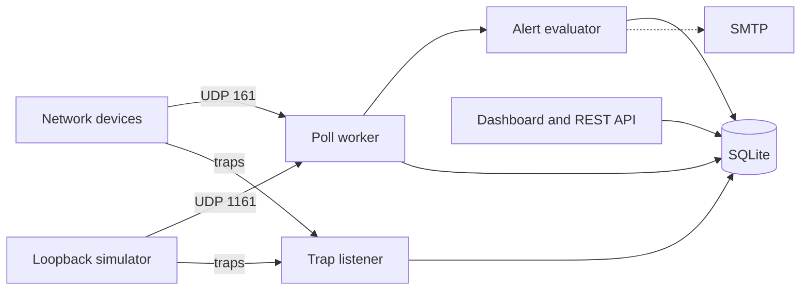

# NetSentinel

NetSentinel is an SNMP network monitor. A single process polls devices, listens for traps, evaluates alerts, and serves the dashboard.

It runs as a console app on Linux and Windows for development, and installs as a Windows Service for production.

## Architecture



| Piece | Role |
| --- | --- |
| `src/NetSentinel.Core` | Counter-delta and bandwidth math, alert evaluation. No I/O. |
| `src/NetSentinel.App` | Worker, SQLite, SNMP polling, trap receiver, Razor dashboard, REST API. |
| `src/NetSentinel.SimAgent` | SNMP v2c agent with moving interface counters, for dev and tests. |
| `tests/NetSentinel.Tests` | Unit tests plus an integration test against the simulator. |

Polling reads `sysDescr`, `sysUpTime`, and `sysName`, then walks `ifTable` and, on v2c/v3, `ifXTable`. 64-bit `ifHCInOctets` / `ifHCOutOctets` are preferred. Bandwidth is `(delta octets × 8) / seconds`. A 32-bit or 64-bit wrap uses modulo arithmetic. If `sysUpTime` goes backwards and the counter decreases, the counter is treated as having restarted. Each device can also carry custom OIDs. Counter-typed custom OIDs get a per-second rate.

Reachability is two signals. SNMP success means the device is up. Ping is reported beside it and, on Linux without permission to open ICMP, shows as `n/a` instead of a false down.

Built-in alerts:

- Device down after N consecutive SNMP failures (default 2), and device up when it recovers.
- Interface down when `ifOperStatus` is down or lower-layer-down and the interface is not administratively down. Unmonitored interfaces are skipped, and an open interface alert closes when the port is unmonitored.
- Reboot when `sysUpTime` decreases between successful polls.
- linkDown and linkUp traps open or clear the same interface-down alert when the port is monitored. The trap is still stored either way. An unmonitored port does not raise an alert.

Threshold rules cover response time, interface bitrates, utilization, and custom OID values or rates. Optional SMTP mail fires when an alert opens or clears.

SQLite stores devices, current interface state, time series, traps, alerts, rules, and settings. Each interface has a `Monitored` flag (default on) and an optional manual override. Existing databases gain those columns, plus the per-device filter columns, the first time the app starts. A retention job deletes samples, traps, and resolved alerts older than the configured number of days. Open alerts are kept.

The dashboard is cookie-authenticated. Credentials live in `appsettings.json`, not in the database. Mutating API calls also require the `X-NetSentinel: 1` header.

## Requirements

- .NET 8 SDK to build. The console app and the Windows Service need the .NET 8 runtime unless you publish self-contained.
- Windows, for the service scripts. The app itself also runs on Linux.
- UDP access to device port 161. Trap port 162 needs an elevated process; development defaults to 1162.

## Configuration

`src/NetSentinel.App/appsettings.json`:

| Key | Default | Meaning |
| --- | --- | --- |
| `Urls` | `http://0.0.0.0:8741` | Dashboard bind address. |
| `Database:Path` | `data/netsentinel.db` | SQLite file, relative to the executable directory. |
| `Dashboard:Username` / `Password` | `admin` / `changeme` | Dashboard login. Change these before exposing the port. |
| `Snmp:TrapPort` | `1162` | Initial trap port. The settings page can change it later; the value is stored in SQLite and applied on startup and on save. |
| `Snmp:TimeoutMs` | `2000` | Per-request SNMP timeout. |
| `Snmp:Retries` | `1` | Extra attempts after a timeout. |
| `Snmp:MaxConcurrentPolls` | `8` | Parallel polls. |
| `Snmp:FailureThreshold` | `2` | Seed value for how many failed polls open a device-down alert. |
| `Retention:Days` | `30` | Seed value for how long samples are kept. |
| `Retention:CleanupIntervalMinutes` | `60` | How often the cleanup job runs. |

The settings page is the place to change retention, the failure threshold, the trap port, and SMTP after the first run. SNMP communities and v3 passwords are stored in the SQLite file for the devices you add. Protect that file.

## Build and test

```bash
dotnet test NetSentinel.sln
```

Unit tests cover 32-bit and 64-bit counter deltas, wraps, reboot resets, utilization, alert rules, interface filter evaluation (including manual override precedence), the SQLite column upgrade, and how the device list groups locations and colors them. The integration test starts the simulator on an ephemeral port, polls it twice, and checks that `Gi0/0` reports about 100 Mbps inbound. A second test sends a trap and parses it.

## Run in the console

From the repository root:

```bash
dotnet run --project src/NetSentinel.App
```

Dashboard: <http://localhost:8741>

In Development the login page shows the default `admin` / `changeme` hint. `dotnet run` uses the Development environment. A Windows Service runs as Production and does not show that hint.

The database is created beside the built executable, typically `src/NetSentinel.App/bin/Debug/net8.0/data/netsentinel.db`.

You can also run the published executable directly. `UseWindowsService()` only hooks the service control manager when the process is actually started as a service, so double-clicking `NetSentinel.exe` is console mode.

### Loopback simulator

In another terminal:

```bash
dotnet run --project src/NetSentinel.SimAgent
```

| | |
| --- | --- |
| Agent | `udp://127.0.0.1:1161` community `public` |
| sysName | `sim-core-01` |
| Gi0/0 | about 100 Mbps in, 24 Mbps out, 1 Gbps link |
| Gi0/1 | lighter traffic |
| Gi0/2 | admin up, oper down |
| Custom OID | `1.3.6.1.4.1.99999.1.0` gauge, a temperature around 42 |
| Trap | one coldStart to `127.0.0.1:1162` shortly after start |

`sim-access-01` is the collapsed-edge example: Gi0/1 (`uplink`), Gi0/2 (`printer`, oper down), and Gi1/0/1 through Gi1/0/24. Most access ports have no ifAlias. Gi1/0/5 is `camera-lobby`, Gi1/0/10–12 have desk aliases, Gi1/0/21–22 are oper down, and Gi1/0/23–24 are administratively down. A filter of exclude `Gi1/0/*`, include `*uplink*`, or "only ports with an ifAlias" shows the difference on the device page.

Flags: `--port`, `--trap`, `--community`, `--no-trap`.

Add a device for `127.0.0.1`, port `1161`, v2c, community `public`. A 5 second poll interval is enough to see the charts move. Bandwidth needs two successful polls because it is a delta.

By default the simulator starts five devices in four locations so the device page and the map have something to show. `sim-dist-02` and `sim-closet-01` bind a UDP port and do not answer SNMP, so the first poll marks them down. IDF-1 then has one device up and one down. Closet is entirely down.

| sysName | UDP port | Location | SNMP |
| --- | --- | --- | --- |
| sim-core-01 | 1161 | MDF | answers |
| sim-dist-01 | 1163 | IDF-1 | answers |
| sim-dist-02 | 1165 | IDF-1 | silent |
| sim-access-01 | 1164 | IDF-2 | answers |
| sim-closet-01 | 1166 | Closet | silent |

Core's Gi0/0 advertises dist, and Gi0/1 advertises access. Both sides advertise the link back. Pass `--single` (or `--port`) to run only the core device. Put the same location on the device form (or in the CSV `location` column) as the table above. The device page groups on that field, not on the SNMP `sysLocation` string by itself. A CSV with those names, hosts `127.0.0.1`, the ports above, locations, and parent `sim-core-01` on the switches is enough to load the lab. The running core device is matched by sysName after its first poll even if its display name is different.

## Using the dashboard

- **Devices.** Grouped by the location field into collapsible cards. Blank locations sit in Unassigned. Matching ignores case and surrounding spaces, so `MDF` and `mdf` are one group. Each card shows the location, the device count, and how many are up (for example `2/3 up`), plus a down count when something is down. The border is green when every device is reporting, amber when some are down, and red when every device is down or any device there has an open or acknowledged critical alert. A label and an icon repeat that state: All reporting, Some down, All down, Critical alert, or Waiting when nothing is down but not every device has reported (or one is paused). Critical and partial groups come first, then locations that are still waiting, then healthy ones, A–Z inside each band. Expand all, collapse all, and which cards are open are remembered in this browser. Search matches name, IP, and location and opens the groups that hit. Down only hides devices that are up. Bubbles and a grouped list are both available, and the choice is remembered. The list reloads from `GET /api/devices/board` about every 45 seconds without reloading the page. Add, edit, delete, import, and export are the same actions as before. Open a device for the interface table and charts. Ranges are 1 hour, 6 hours, 24 hours, and 7 days. Each interface row has a monitored checkbox. Select rows for "Monitor only selected", or unmonitor every down and admin-down port. "Clear manual overrides" lets the filters decide again. Unmonitored ports stay in the table only while "Show unmonitored" is on. They are still discovered, but polls do not keep bandwidth history for them and they do not raise interface or threshold alerts.
- **Edit.** Host, port, per-device poll interval, v1/v2c community, or v3 user with MD5/SHA-1/SHA-256/SHA-384/SHA-512 and DES/AES/AES-192/AES-256. Leave a stored v3 password blank to keep it. Custom OIDs are edited on the same form.
- **Alerts.** Open and acknowledged items, plus history. Ack and resolve are manual; a cleared condition resolves the matching alert on the next poll.
- **Traps.** Newest first, with varbinds. v1 and v2c are stored as they arrive. v3 traps are decrypted when the username matches a configured device. Informs get a response so the sender does not retry.
- **Settings.** Retention, failure threshold, trap listener, SMTP, and threshold rules.
- **Interface filters.** On the device page, include and exclude patterns match ifName, ifDescr, and ifAlias (you can turn fields off). Syntax is a whole-string glob (`Gi1/0/*`, `*uplink*`, `?` for one character) or a regular expression. Separate alternatives with `;`. When a port matches both, exclude wins. Optional switches skip administratively down ports and ports with an empty ifAlias. A manual checkbox overrides the rules for that port. Filters are reapplied on each poll and when you save them, so newly discovered ports follow the policy.
- **Import.** Upload a CSV (template and export use the same columns). The preview lists ready rows, duplicates of devices you already have, and per-row errors. Choose skip or update for duplicates, then commit. Headers are case-insensitive and can appear in any order. Quoted commas are supported. The limit is 1,000 devices. Optional columns: `if_include`, `if_exclude`, `if_pattern` (`glob` or `regex`), `if_match` (`name`, `descr`, `alias`), `if_exclude_admin_down`, and `if_require_alias`. A missing column leaves the stored filter alone on update. An empty column clears it.
- **Map.** Devices are nodes colored by live status. Edges come from LLDP (`lldpRemTable`) and CDP (`cdpCacheTable`) when the neighbor's sysName, chassis id, or management address matches one known device, plus the parent/uplink field and any manual link you add. A matched local interface shows link utilization when that port is monitored. "Show unmonitored" puts the percentage back. Drag a node to save its position. Group by the CSV group or location fields. Click a node to open the device. The map refreshes every 15 seconds.

REST endpoints under `/api` accept the same cookie and, for POST, PUT, and DELETE, the header `X-NetSentinel: 1`. `GET /health` is anonymous. `GET /api/devices/board` returns the location groups, health, and the same device rows the Devices page draws.

Interface monitoring:

| Method | Path | Body |
| --- | --- | --- |
| GET, PUT | `/api/devices/{id}/interface-policy` | include/exclude patterns, `syntax` (`glob` or `regex`), `matchName`, `matchDescr`, `matchAlias`, `excludeAdminDown`, `requireAlias` |
| PUT | `/api/devices/{id}/interfaces/{ifIndex}/monitored` | `{ "monitored": false }` sets a manual override. `{ "clearOverride": true }` follows the rules again. |
| POST | `/api/devices/{id}/interfaces/monitoring` | `{ "action": "only-selected" \| "unmonitor-down" \| "clear-overrides", "ifIndexes": [1, 2] }` |

`GET /api/devices/{id}` includes every discovered interface, the policy, and `monitored` / `monitorOverride` on each row. `?monitoredOnly=true` drops the unmonitored rows. `GET /api/map?showUnmonitored=true` includes utilization for links whose local port is not monitored.

## Windows Service

On the Windows machine that will run the service, in an elevated PowerShell:

```powershell
.\scripts\Install-Service.ps1
.\scripts\Install-Service.ps1 -DashboardPort 8741 -TrapPort 162 -SelfContained
.\scripts\Uninstall-Service.ps1
.\scripts\Uninstall-Service.ps1 -RemoveFiles
```

The install script:

1. Publishes `src/NetSentinel.App` in Release with `dotnet publish`.
2. Writes the dashboard URL and trap port into the published `appsettings.json`.
3. Copies the publish output to `C:\Program Files\NetSentinel`.
4. Registers a service named `NetSentinel` (`New-Service`) that restarts on failure, then starts it.
5. Opens the dashboard TCP port and the trap UDP port in Windows Firewall.

The machine that runs the script needs the .NET 8 SDK. The service host needs the .NET 8 runtime unless you pass `-SelfContained`.

After installation the dashboard is at `http://localhost:<DashboardPort>`. Sign in with the credentials in the published `appsettings.json`. The script leaves the shipped default (`admin` / `changeme`) in place; change it in that file and restart the service before other people can reach the port.

`TrapPort 162` is the usual production choice. The service runs as LocalSystem, which can bind that port. Development builds stay on 1162 so they do not need extra privileges.

Uninstall stops and deletes the service and the two firewall rules. Files stay unless you pass `-RemoveFiles`.

## Linux notes

The Windows Service package is a no-op outside Windows, so `dotnet run` is the development path. Binding UDP 162 requires root; use 1162 or another unprivileged port. ICMP ping may be unavailable without `CAP_NET_RAW`. SNMP polling does not need it.

## Security

This is an operations tool for a trusted network. The dashboard password is compared in constant time but is stored in config, and SNMP secrets are stored in SQLite. Do not publish port 8741 to the internet. Use a firewall, change the default password, and keep the database file readable only by the service account.
