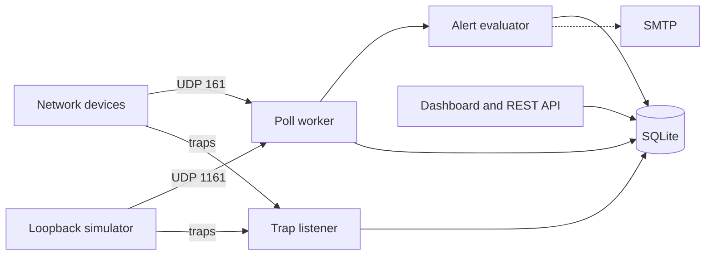

# NetSentinel

NetSentinel is an SNMP network monitor. A single process polls devices, listens for traps, evaluates alerts, and serves the dashboard.

It runs as a console app on Linux and Windows for development, and installs as a Windows Service for production.

## Architecture



| Piece | Role |
| --- | --- |
| `src/NetSentinel.Core` | Counter-delta and bandwidth math, alert evaluation. No I/O. |
| `src/NetSentinel.App` | Worker, SQLite, SNMP polling, trap receiver, Razor dashboard, REST API. |
| `src/NetSentinel.SimAgent` | SNMP v2c agent with moving interface counters, for dev and tests. |
| `tests/NetSentinel.Tests` | Unit tests plus an integration test against the simulator. |

Polling reads `sysDescr`, `sysUpTime`, and `sysName`, then walks `ifTable` and, on v2c/v3, `ifXTable`. 64-bit `ifHCInOctets` / `ifHCOutOctets` are preferred. Bandwidth is `(delta octets × 8) / seconds`. A 32-bit or 64-bit wrap uses modulo arithmetic. If `sysUpTime` goes backwards and the counter decreases, the counter is treated as having restarted. Each device can also carry custom OIDs. Counter-typed custom OIDs get a per-second rate.

Reachability is two signals. SNMP success means the device is up. Ping is reported beside it and, on Linux without permission to open ICMP, shows as `n/a` instead of a false down.

Built-in alerts:

- Device down after N consecutive SNMP failures (default 2), and device up when it recovers.
- Interface down when `ifOperStatus` is down or lower-layer-down and the interface is not administratively down.
- Reboot when `sysUpTime` decreases between successful polls.

Threshold rules cover response time, interface bitrates, utilization, and custom OID values or rates. Optional SMTP mail fires when an alert opens or clears.

SQLite stores devices, current interface state, time series, traps, alerts, rules, and settings. A retention job deletes samples, traps, and resolved alerts older than the configured number of days. Open alerts are kept.

The dashboard is cookie-authenticated. Credentials live in `appsettings.json`, not in the database. Mutating API calls also require the `X-NetSentinel: 1` header.

## Requirements

- .NET 8 SDK to build. The console app and the Windows Service need the .NET 8 runtime unless you publish self-contained.
- Windows, for the service scripts. The app itself also runs on Linux.
- UDP access to device port 161. Trap port 162 needs an elevated process; development defaults to 1162.

## Configuration

`src/NetSentinel.App/appsettings.json`:

| Key | Default | Meaning |
| --- | --- | --- |
| `Urls` | `http://0.0.0.0:8741` | Dashboard bind address. |
| `Database:Path` | `data/netsentinel.db` | SQLite file, relative to the executable directory. |
| `Dashboard:Username` / `Password` | `admin` / `changeme` | Dashboard login. Change these before exposing the port. |
| `Snmp:TrapPort` | `1162` | Initial trap port. The settings page can change it later; the value is stored in SQLite and applied on startup and on save. |
| `Snmp:TimeoutMs` | `2000` | Per-request SNMP timeout. |
| `Snmp:Retries` | `1` | Extra attempts after a timeout. |
| `Snmp:MaxConcurrentPolls` | `8` | Parallel polls. |
| `Snmp:FailureThreshold` | `2` | Seed value for how many failed polls open a device-down alert. |
| `Retention:Days` | `30` | Seed value for how long samples are kept. |
| `Retention:CleanupIntervalMinutes` | `60` | How often the cleanup job runs. |

The settings page is the place to change retention, the failure threshold, the trap port, and SMTP after the first run. SNMP communities and v3 passwords are stored in the SQLite file for the devices you add. Protect that file.

## Build and test

```bash
dotnet test NetSentinel.sln
```

Unit tests cover 32-bit and 64-bit counter deltas, wraps, reboot resets, utilization, and alert rules. The integration test starts the simulator on an ephemeral port, polls it twice, and checks that `Gi0/0` reports about 100 Mbps inbound. A second test sends a trap and parses it.

## Run in the console

From the repository root:

```bash
dotnet run --project src/NetSentinel.App
```

Dashboard: <http://localhost:8741>

In Development the login page shows the default `admin` / `changeme` hint. `dotnet run` uses the Development environment. A Windows Service runs as Production and does not show that hint.

The database is created beside the built executable, typically `src/NetSentinel.App/bin/Debug/net8.0/data/netsentinel.db`.

You can also run the published executable directly. `UseWindowsService()` only hooks the service control manager when the process is actually started as a service, so double-clicking `NetSentinel.exe` is console mode.

### Loopback simulator

In another terminal:

```bash
dotnet run --project src/NetSentinel.SimAgent
```

| | |
| --- | --- |
| Agent | `udp://127.0.0.1:1161` community `public` |
| sysName | `sim-core-01` |
| Gi0/0 | about 100 Mbps in, 24 Mbps out, 1 Gbps link |
| Gi0/1 | lighter traffic |
| Gi0/2 | admin up, oper down |
| Custom OID | `1.3.6.1.4.1.99999.1.0` gauge, a temperature around 42 |
| Trap | one coldStart to `127.0.0.1:1162` shortly after start |

Flags: `--port`, `--trap`, `--community`, `--no-trap`.

Add a device for `127.0.0.1`, port `1161`, v2c, community `public`. A 5 second poll interval is enough to see the charts move. Bandwidth needs two successful polls because it is a delta.

## Using the dashboard

- **Devices.** Status, sysName, uptime, response time, and ping. Open a device for the interface table and charts. Ranges are 1 hour, 6 hours, 24 hours, and 7 days.
- **Edit.** Host, port, per-device poll interval, v1/v2c community, or v3 user with MD5/SHA-1/SHA-256/SHA-384/SHA-512 and DES/AES/AES-192/AES-256. Leave a stored v3 password blank to keep it. Custom OIDs are edited on the same form.
- **Alerts.** Open and acknowledged items, plus history. Ack and resolve are manual; a cleared condition resolves the matching alert on the next poll.
- **Traps.** Newest first, with varbinds. v1 and v2c are stored as they arrive. v3 traps are decrypted when the username matches a configured device. Informs get a response so the sender does not retry.
- **Settings.** Retention, failure threshold, trap listener, SMTP, and threshold rules.

REST endpoints under `/api` accept the same cookie and, for POST, PUT, and DELETE, the header `X-NetSentinel: 1`. `GET /health` is anonymous.

## Windows Service

On the Windows machine that will run the service, in an elevated PowerShell:

```powershell
.\scripts\Install-Service.ps1
.\scripts\Install-Service.ps1 -DashboardPort 8741 -TrapPort 162 -SelfContained
.\scripts\Uninstall-Service.ps1
.\scripts\Uninstall-Service.ps1 -RemoveFiles
```

The install script:

1. Publishes `src/NetSentinel.App` in Release with `dotnet publish`.
2. Writes the dashboard URL and trap port into the published `appsettings.json`.
3. Copies the publish output to `C:\Program Files\NetSentinel`.
4. Registers a service named `NetSentinel` (`New-Service`) that restarts on failure, then starts it.
5. Opens the dashboard TCP port and the trap UDP port in Windows Firewall.

The machine that runs the script needs the .NET 8 SDK. The service host needs the .NET 8 runtime unless you pass `-SelfContained`.

After installation the dashboard is at `http://localhost:<DashboardPort>`. Sign in with the credentials in the published `appsettings.json`. The script leaves the shipped default (`admin` / `changeme`) in place; change it in that file and restart the service before other people can reach the port.

`TrapPort 162` is the usual production choice. The service runs as LocalSystem, which can bind that port. Development builds stay on 1162 so they do not need extra privileges.

Uninstall stops and deletes the service and the two firewall rules. Files stay unless you pass `-RemoveFiles`.

## Linux notes

The Windows Service package is a no-op outside Windows, so `dotnet run` is the development path. Binding UDP 162 requires root; use 1162 or another unprivileged port. ICMP ping may be unavailable without `CAP_NET_RAW`. SNMP polling does not need it.

## Security

This is an operations tool for a trusted network. The dashboard password is compared in constant time but is stored in config, and SNMP secrets are stored in SQLite. Do not publish port 8741 to the internet. Use a firewall, change the default password, and keep the database file readable only by the service account.
